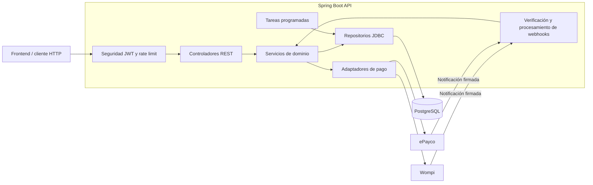
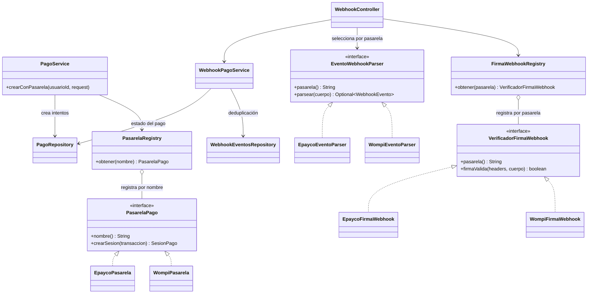
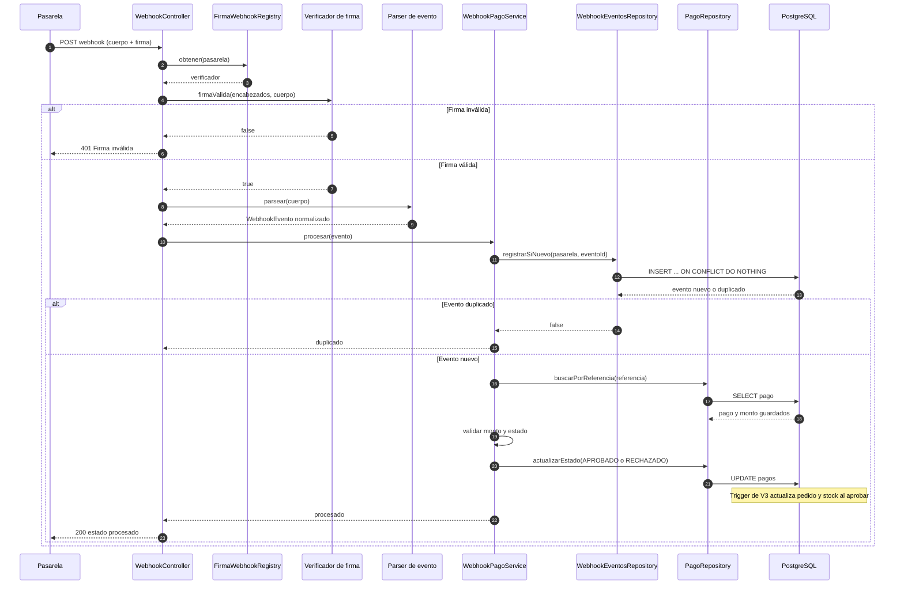
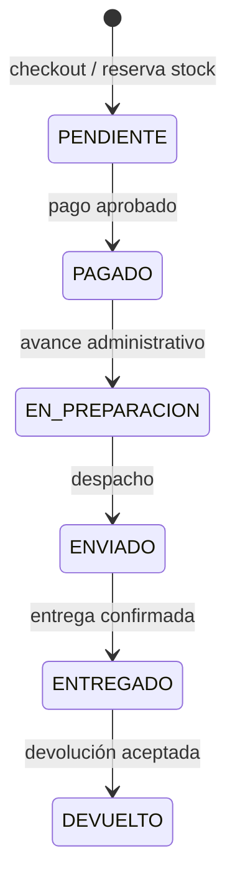

# tienda-api

API REST para una tienda de comercio electrónico, construida con Spring Boot, Java y PostgreSQL. Incluye autenticación JWT, catálogo, carrito, pedidos, pagos, inventario, facturación y administración.

> **Estado de Redis y MinIO:** Redis se usa para la caché opcional del catálogo (`CACHE_TYPE=redis`); el rate limiting sigue en memoria. El almacenamiento de imágenes sigue la configuración existente.

## Contenido

- [Tecnologías](#tecnologías)
- [Funcionalidades](#funcionalidades)
- [Arquitectura](#arquitectura)
- [Requisitos](#requisitos)
- [Configuración](#configuración)
- [Ejecución local](#ejecución-local)
- [Despliegue con Docker](#despliegue-con-docker)
- [API](#api)
- [Autenticación y permisos](#autenticación-y-permisos)
- [Pagos y webhooks](#pagos-y-webhooks)
- [Base de datos](#base-de-datos)
- [Pruebas](#pruebas)
- [Seguridad y limitaciones](#seguridad-y-limitaciones)
- [Siguiente etapa: Redis y MinIO](#siguiente-etapa-redis-y-minio)
- [Solución de problemas](#solución-de-problemas)

## Tecnologías

- Java 21 y Spring Boot 3.3.5.
- Spring MVC, Spring Security, validación y Actuator.
- JDBC con `JdbcTemplate` y PostgreSQL 16.
- Flyway para versionar el esquema de base de datos.
- JWT para autenticación y BCrypt para contraseñas.
- JUnit, Spring Boot Test y Testcontainers para pruebas.
- Maven para compilación y gestión de dependencias.

## Funcionalidades

- Registro, login, JWT y refresh tokens rotativos con revocación de sesiones.
- Catálogo público con categorías, búsqueda, paginación y productos con stock.
- Administración de productos, imágenes por URL y atributos.
- Carrito, direcciones, cupones y checkout transaccional.
- Reserva y expiración automática de stock; reglas de negocio protegidas por triggers de PostgreSQL.
- Pedidos, pagos, estados, envíos, reseñas verificadas y facturas idempotentes.
- Integración de pagos con Wompi y ePayco, incluyendo validación y deduplicación de webhooks.
- Reportes administrativos de ventas e inventario.
- Limitación de solicitudes por IP y respuestas de error `ProblemDetail`.

## Arquitectura

La aplicación está organizada por dominios bajo `com.codeconheiner.tienda`:

| Paquete | Responsabilidad |
| --- | --- |
| `auth` | Registro, login, JWT y ciclo de vida de refresh tokens. |
| `catalogo` | Catálogo público y administración de productos, imágenes y atributos. |
| `carrito`, `direcciones`, `cupones` | Compras previas al checkout y sus reglas. |
| `pedidos`, `inventario`, `envios` | Checkout, stock, estados y logística. |
| `pagos`, `webhooks` | Pasarelas, sesiones de pago y notificaciones firmadas. |
| `facturas`, `reportes`, `resenas` | Documentos, consultas administrativas y reseñas. |
| `usuarios` | Persistencia y consulta de usuarios y roles. |
| `config`, `seguridad` | Configuración, filtros y tareas programadas. |
| `common` | Manejo de errores, hashes y limitación de solicitudes. |

Los controladores reciben solicitudes, los servicios coordinan reglas de aplicación y los repositorios ejecutan SQL con `JdbcTemplate`. La API utiliza Problem Details para mantener respuestas de error consistentes.

### Diagrama de componentes



### UML de clases: pagos extensibles

El registro resuelve cada implementación por nombre. Los contratos separados permiten agregar una pasarela sin acoplar `PagoService` a un proveedor concreto.



### UML de secuencia: confirmación de pago



### UML de estados: pedido



## Requisitos

- JDK 21.
- Maven 3.9 o compatible; o Docker para construir y ejecutar la imagen.
- PostgreSQL 16 accesible para la aplicación.
- Docker Compose si se usará el despliegue del homelab.

## Configuración

Para desarrollo local, crea la configuración de entorno a partir de la plantilla:

```bash
cp .env.example .env
```

Configura al menos la conexión de PostgreSQL y un secreto JWT de 32 bytes o más. Puedes generar uno con:

```bash
openssl rand -base64 48
```

No publiques `.env` ni compartas sus valores. `ADMIN_PASSWORD` es opcional: al iniciar la aplicación se crea el administrador inicial solo si la contraseña está definida y `ADMIN_EMAIL` aún no existe. No cambia la contraseña de una cuenta existente.

| Variable | Valor predeterminado | Descripción |
| --- | --- | --- |
| `DB_URL` | `jdbc:postgresql://localhost:5432/tienda` | URL JDBC cuando la aplicación se ejecuta fuera de Compose. |
| `DB_NAME` | `tienda` | Nombre de base usado por el `docker-compose.yml` de la API. |
| `DB_USER` | `tienda` | Usuario PostgreSQL. |
| `DB_PASSWORD` | `tienda` en `application.yml`; Compose la exige | Contraseña PostgreSQL. Usa un valor seguro. |
| `JWT_SECRET` | Vacío | Obligatorio; la aplicación falla al iniciar si falta o tiene menos de 32 bytes. |
| `ADMIN_EMAIL` | `admin@tienda.local` | Correo para el administrador inicial. |
| `ADMIN_PASSWORD` | Vacío | Si se define, permite crear el administrador inicial si no existe. |
| `CORS_ORIGINS` | `http://localhost:5173` | Orígenes CORS permitidos. |
| `TIENDA_NOMBRE` | `TechStore` | Nombre público de la tienda. |
| `CACHE_TYPE` | `none` | `none` (sin Redis, desarrollo) o `redis` (producción). |
| `CACHE_TTL_PRODUCTOS` | `60s` | TTL para detalle de producto. |
| `CACHE_TTL_LISTADOS` | `30s` | TTL para listado de catálogo. |
| `CACHE_TTL_CATEGORIAS` | `1h` | TTL para categorías. |
| `CACHE_TTL_TIENDA` | `1h` | TTL para datos de tienda. |
| `REDIS_HOST/PORT/PASSWORD` | `localhost/6379/` | Conexión Redis cuando `CACHE_TYPE=redis`. |
| `RATE_LIMIT_MAXIMO` | `300` | Solicitudes generales por IP y ventana. |
| `RATE_LIMIT_AUTH_MAXIMO` | `10` | Solicitudes de login, registro y refresh por IP y ventana. |
| `PAGOS_MODO` | `simulado` | `simulado` o `real`. El modo real utiliza las URLs configuradas. |
| `WOMPI_API_URL` | `https://api.sandbox.wompi.co/v1` | URL de API Wompi. |
| `WOMPI_PUBLIC_KEY` / `WOMPI_PRIVATE_KEY` | Vacías | Credenciales Wompi. |
| `WOMPI_INTEGRITY_SECRET` | Vacío | Secreto para verificar la firma de webhooks Wompi. |
| `WOMPI_REDIRECT_URL` | `http://localhost:5173/pago/exitoso` | URL de retorno del checkout Wompi. |
| `EPAYCO_API_URL` | `https://api.secure.epayco.co` | URL de API ePayco. |
| `EPAYCO_APIIFY_URL` | `https://apify.epayco.co` | URL auxiliar configurada para ePayco. |
| `EPAYCO_PUBLIC_KEY` / `EPAYCO_PRIVATE_KEY` | Vacías | Credenciales ePayco; la clave privada verifica el webhook actual. |

Con `PAGOS_MODO=simulado`, la API no llama servicios externos. Configura las variables de pagos según la pasarela que utilices.

## Ejecución local

Con PostgreSQL disponible y las variables definidas en el entorno:

```bash
mvn spring-boot:run
```

La aplicación escucha en `http://localhost:8080`. Flyway valida y aplica las migraciones durante el arranque.

Para compilar sin ejecutar pruebas:

```bash
mvn -B -q package -DskipTests
```

## Despliegue con Docker

El Compose de este repositorio levanta la API, no PostgreSQL. En la configuración actual, la API se conecta al servicio `web_db` por el puerto interno `5432` y a la red Docker externa `homelab_net`.

1. Verifica que `web_db` esté activo y conectado a `homelab_net`.
2. Crea `.env` a partir de `.env.example` y configura los datos de la base `web`, `JWT_SECRET` y las credenciales necesarias.
3. Asegúrate de que la dirección `192.168.0.150` de `ports` en `docker-compose.yml` corresponda al host. Cámbiala si el servidor usa otra IP.
4. Desde la carpeta del proyecto ejecuta:

```bash
docker compose up -d --build
docker compose ps
docker compose logs -f api
```

URLs con la configuración actual:

- API: `http://192.168.0.150:8080`
- Swagger UI: `http://192.168.0.150:8080/swagger-ui.html`
- OpenAPI: `http://192.168.0.150:8080/v3/api-docs`
- Salud: `http://192.168.0.150:8080/actuator/health`

Dentro de la red Docker se usa `web_db:5432`; el puerto publicado de PostgreSQL en el host no es el puerto que deben usar los contenedores entre sí. La red externa se declara en `docker-compose.yml` y debe existir antes de levantar la API.

## API

La documentación interactiva está en Swagger UI. Resumen de rutas principales:

| Método | Ruta | Acceso | Uso |
| --- | --- | --- | --- |
| `POST` | `/api/auth/registro` | Público | Registra un cliente. |
| `POST` | `/api/auth/login` | Público | Inicia sesión y devuelve JWT y refresh token. |
| `POST` | `/api/auth/refresh` | Público | Rota el refresh token. |
| `POST` | `/api/auth/logout` | Autenticado | Revoca el refresh token. |
| `PUT` | `/api/auth/password` | Autenticado | Cambia la contraseña e invalida sesiones anteriores. |
| `GET` | `/api/catalogo/tienda` | Público | Configuración visible de la tienda. |
| `GET` | `/api/catalogo/categorias` | Público | Categorías activas. |
| `GET` | `/api/catalogo/productos` | Público | Productos activos con stock; acepta `categoriaId`, `q`, `page`, `size`. |
| `GET` | `/api/catalogo/productos/{id}` | Público | Detalle con imágenes y atributos; requiere producto activo y con stock. |
| `POST` | `/api/admin/productos` | `ADMIN` | Crea producto e inventario inicial. |
| `PUT` | `/api/admin/productos/{id}` | `ADMIN` | Actualiza datos del producto e inventario. |
| `DELETE` | `/api/admin/productos/{id}` | `ADMIN` | Desactiva lógicamente el producto. |
| `POST` | `/api/admin/productos/{id}/imagen` | `ADMIN` | Sube la imagen principal (`multipart/form-data`, campo `file`). Guarda clave en `productos.imagen_key` y sincroniza galería. |
| `DELETE` | `/api/admin/productos/{id}/imagen` | `ADMIN` | Elimina imagen principal y objeto en S3. |
| `POST` | `/api/admin/productos/imagenes` | `ADMIN` | Sube archivo (`multipart/form-data`, `archivo`) con prefijo `productos/sin-asignar` o acepta `imagenUrl` (http/https). |
| `POST` | `/api/admin/productos/{id}/imagenes` | `ADMIN` | Agrega entrada a galería por JSON (`url`, `orden`, `esPrincipal`). |
| `POST` | `/api/admin/productos/{id}/imagenes/upload` | `ADMIN` | Sube archivo a galería (`multipart/form-data`, `archivo`) con StorageService. |
| `DELETE` | `/api/admin/productos/{id}/imagenes/{imagenId}` | `ADMIN` | Elimina registro de galería; si es URL propia borra objeto S3 (best effort). |
| `POST` / `DELETE` | `/api/admin/productos/{id}/atributos[/{clave}]` | `ADMIN` | Gestiona atributos clave/valor. |
| `GET` / `POST` / `PUT` / `DELETE` | `/api/carrito` y `/api/carrito/items` | Autenticado | Consulta y modifica el carrito propio. |
| `GET` / `POST` / `PUT` / `DELETE` | `/api/direcciones` | Autenticado | Gestiona direcciones propias. |
| `POST` | `/api/pedidos` | Autenticado | Checkout, reserva stock y vacía el carrito. |
| `GET` | `/api/pedidos` y `/api/pedidos/{id}` | Autenticado | Consulta pedidos propios. |
| `GET` | `/api/pedidos/{id}/factura` | Autenticado | Emite o consulta la factura propia de un pedido pagado. |
| `GET` / `POST` | `/api/pagos/pedido/{pedidoId}`, `/api/pagos` | Autenticado | Consulta pagos o registra un intento. |
| `POST` | `/api/pagos/sesion` | Autenticado | Crea o reutiliza una sesión de pasarela. |
| `GET` | `/api/inventario/productos/{productoId}/stock` | Público | Consulta stock. |
| `GET` | `/api/cupones/validar?codigo=&monto=` | Público | Valida un cupón. |
| `GET` | `/api/resenas/producto/{productoId}` | Público | Consulta reseñas de un producto. |
| `POST` | `/api/resenas` | Autenticado | Crea una reseña; requiere compra entregada. |
| `GET` | `/api/envios/pedido/{pedidoId}` | Autenticado | Consulta el envío asociado a un pedido. |
| `POST` | `/api/webhooks/wompi`, `/api/webhooks/epayco` | Público, firmado | Recibe confirmaciones de pago de las pasarelas. |
| `GET` | `/actuator/health` | Público | Salud de la aplicación. |

Rutas administrativas adicionales, todas con rol `ADMIN`:

| Grupo | Rutas |
| --- | --- |
| Pedidos | `/api/admin/pedidos`, `/api/admin/pedidos/{id}`, `/api/admin/pedidos/{id}/estado`, `/api/admin/pedidos/{id}/factura` |
| Cupones | `/api/admin/cupones`, `/api/admin/cupones/{id}` |
| Envíos | `/api/admin/envios`, `/api/admin/envios/{id}` |
| Inventario | `/api/admin/inventario/stock-bajo` |
| Reportes | `/api/admin/reportes/ventas?desde=&hasta=`, `/api/admin/reportes/inventario` |

### Ejemplo: autenticación y catálogo

El login responde con los campos `token`, `tipo`, `expiraEnSegundos`, `nombre`, `rol` y `refreshToken`. Envía el token de acceso en la cabecera `Authorization`:

```bash
curl -sS -X POST http://localhost:8080/api/auth/login \
  -H 'Content-Type: application/json' \
  -d '{"email":"admin@tienda.local","password":"TU_CONTRASEÑA"}'

curl -i http://localhost:8080/api/catalogo/productos
```

Para administrar productos, usa `Authorization: Bearer <token>`. La cuenta debe tener el rol `ADMIN`.

### Imágenes de productos

- **Imagen principal**: `productos.imagen_key` es la fuente de verdad. `POST /api/admin/productos/{id}/imagen` sube con `StorageService`, actualiza la clave, sincroniza `producto_imagenes` (pone otras como no principales, reemplaza fila de la principal anterior, inserta nueva con `es_principal=true`, `orden=0`) y borra el objeto anterior (best effort).
- **Galería**: `POST /api/admin/productos/{id}/imagenes/upload` sube archivo con `StorageService`. `POST /api/admin/productos/{id}/imagenes` acepta JSON con `url`. `POST /api/admin/productos/imagenes` sube archivo con prefijo `productos/sin-asignar` o acepta `imagenUrl` http/https válida.
- **Eliminación**: `DELETE /api/admin/productos/{id}/imagen` borra objeto y limpia galería/clave. `DELETE /api/admin/productos/{id}/imagenes/{imagenId}` borra la fila; si la URL es propia (`STORAGE_PUBLIC_URL`) intenta borrar el objeto S3 (best effort).
- **Almacenamiento**: S3-compatible (RustFS). Las claves se generan con UUID, nunca con el nombre original. `Cache-Control: public, max-age=31536000, immutable`. Al borrar un objeto el CDN puede seguir sirviéndolo hasta expirar o purgarse. `STORAGE_PUBLIC_URL_INCLUYE_BUCKET` controla si la URL pública incluye el bucket.
- **Nota**: puede existir una fila de galería con placeholder tipo `https://<HOST_DE_IMAGENES>/...` (producto 1 en producción). No se borra automáticamente por código/migración; requiere limpieza manual.

El catálogo público solo muestra productos activos con stock disponible. El `PUT` actualiza los datos e inventario, pero no reactiva productos; actualmente la API no expone un endpoint de reactivación.

## Autenticación y permisos

- Las rutas públicas no requieren token.
- `/api/admin/**` requiere un JWT válido con rol `ADMIN`.
- Carrito, pedidos, pagos, direcciones y operaciones propias requieren autenticación.
- En solicitudes protegidas utiliza `Authorization: Bearer <token>`.
- El JWT se firma con `JWT_SECRET`; la expiración de acceso se configura en `tienda.jwt.expiracion-minutos` (120 minutos por defecto).
- Los refresh tokens se almacenan como hash, se rotan al refrescar y tienen una vigencia de siete días.
- Las contraseñas de usuario se almacenan con BCrypt.

Errores frecuentes: `400` validación o JSON inválido; `401` autenticación ausente/inválida; `403` rol insuficiente; `404` recurso inexistente/no disponible; `409` conflicto o restricción; `422` regla de negocio de PostgreSQL; `429` límite de solicitudes superado; `500` error inesperado. Los errores se responden como `ProblemDetail`, con mensajes en español.

## Pagos y webhooks

El flujo de pago es:

1. El cliente crea el pedido con `POST /api/pedidos`; el stock se reserva y el pedido queda pendiente.
2. Solicita `POST /api/pagos/sesion` con el pedido, la pasarela (`WOMPI` o `EPAYCO`) y, cuando corresponda, la clave de idempotencia.
3. La API devuelve los datos de la sesión y la URL de pago para el frontend.
4. La pasarela notifica el resultado a `/api/webhooks/wompi` o `/api/webhooks/epayco`.
5. La API valida la firma y el pago, deduplica eventos repetidos y actualiza el pedido. Un pago aprobado marca el pedido como pagado y descuenta el stock reservado.

En modo `simulado` no se invocan APIs externas. En modo `real` se utilizan las URLs y credenciales configuradas; el ejemplo de Wompi apunta al sandbox. Los secretos de pasarela deben configurarse únicamente en el servidor.

## Base de datos

Flyway administra el esquema en `src/main/resources/db/migration`:

| Migración | Contenido |
| --- | --- |
| V1 | Esquema inicial de usuarios, catálogo, inventario, carrito, pedidos y dominios relacionados. |
| V2 | Roles `ADMIN` y `CLIENTE`, y categorías iniciales. |
| V3 | Triggers y funciones para stock, pedidos, cupones, direcciones y reglas de negocio. |
| V4 | Persistencia de refresh tokens. |
| V5 | Facturas, eventos de webhook e idempotencia de pagos. |
| V6 | Familias de refresh tokens, auditoría e índices adicionales. |

En Compose, la API se conecta al PostgreSQL existente `web_db`, en la base definida por `DB_NAME`. No uses la base de producción para pruebas automatizadas que limpian fixtures. Las pruebas PostgreSQL locales apuntan específicamente a `localhost:5432/tienda_db`; `PostgresIntegrationTest` crea una base temporal independiente con Testcontainers.

## Pruebas

Pruebas unitarias y MVC sin PostgreSQL externo:

```bash
mvn -Dtest='AuthServiceTest,ApiEndpointsTest,ModulosEndpointsTest,RateLimitingTest,VentanaDeslizanteRateLimiterTest,PasarelasTest' test
```

Pruebas SQL y flujo HTTP contra PostgreSQL auxiliar local. Requieren `tienda_db` en `localhost:5432`, usuario `tienda_user` y contraseña `tienda_pass`:

```bash
mvn -Dtest='RepositoriosPostgresTest,FlujoCompletoPostgresTest' test
```

Pruebas contra PostgreSQL temporal gestionado por Testcontainers:

```bash
mvn -Dtest=PostgresIntegrationTest test
```

Testcontainers requiere que Docker sea accesible para el proceso Maven; si no lo es, esta clase está configurada para omitirse. Para ejecutar toda la suite:

```bash
mvn test
```

Las pruebas `RepositoriosPostgresTest` y `FlujoCompletoPostgresTest` limpian sus propios datos de prueba. Usa una base auxiliar desechable, nunca la base de producción.

## Seguridad y limitaciones

- Configura secretos únicos y robustos; no incluyas `.env`, JWT, contraseñas ni claves de pasarela en Git o en logs compartidos.
- El administrador inicial se crea solo si no existe. Cambiar `ADMIN_PASSWORD` no modifica una cuenta previamente creada.
- El rate limiter usa una ventana deslizante en memoria por instancia; no comparte contadores entre réplicas y no está respaldado por Redis.
- Las imágenes son URLs guardadas en PostgreSQL; no hay carga de archivos ni almacenamiento MinIO.
- Los productos se desactivan de forma lógica. No existe todavía una ruta de API para reactivarlos.
- Las reglas críticas de negocio también se aplican en PostgreSQL; los errores SQLSTATE `P0001` se convierten en HTTP `422`.
- La caché Redis aplica solo a lecturas públicas de catálogo. Si Redis falla, la API continúa consultando PostgreSQL; el health de Redis está excluido de `/actuator/health` y sus probes.
- Stock y reservas se invalidan después de las operaciones Java de checkout, estados de pedido, aprobación de pagos, devolución de envío y expiración de reservas. Escrituras directas en PostgreSQL u otros clientes que disparen los triggers no notifican a esta instancia; los TTL predeterminados son 60 s para detalles y 30 s para listados para acotar esa posible obsolescencia.

## Siguiente etapa: Redis y MinIO

La caché Redis está disponible de forma opcional (`CACHE_TYPE=redis`), mientras que el rate limiting permanece en memoria. El almacenamiento de imágenes utiliza la configuración existente.

### Redis para caché

La caché cubre tienda, categorías, listado y detalle público. El TTL es configurable por entorno; cambios de catálogo hechos desde la API invalidan las entradas afectadas. PostgreSQL no publica invalidaciones para escrituras externas, por lo que deben considerarse los TTL de respaldo documentados en Seguridad y limitaciones. Una caída de Redis no desactiva la API ni cambia el estado de health.

### MinIO para imágenes

Objetivo: recibir archivos de imagen y almacenarlos como objetos, en vez de guardar URLs suministradas manualmente. La integración deberá contemplar:

- Cliente MinIO y configuración externa de endpoint, bucket y credenciales.
- Endpoint administrativo de carga multipart, límites de tamaño y validación de tipo/contenido.
- Persistencia en PostgreSQL de la clave del objeto y sus metadatos, no de los bytes del archivo.
- Entrega de URL pública o firmada según la política de acceso definida.
- Eliminación coordinada del objeto y su referencia al borrar una imagen.
- Pruebas de carga, consulta, permisos y errores de almacenamiento.

Redis y MinIO deberán quedar configurables por entorno, con credenciales fuera del repositorio. La implementación debe preservar el comportamiento actual hasta que la migración de clientes y despliegue esté lista.

## Solución de problemas

| Síntoma | Comprobación |
| --- | --- |
| La API no conecta a PostgreSQL en Docker | Verifica que `web_db` esté activo, en `homelab_net`, y que `DB_NAME`, `DB_USER` y `DB_PASSWORD` coincidan. Entre contenedores usa `web_db:5432`. |
| La API falla al iniciar por JWT | Define `JWT_SECRET` con al menos 32 bytes. |
| Login ADMIN da `401` | Usa el correo y contraseña actuales de la cuenta. `ADMIN_PASSWORD` solo crea la cuenta si no existía; no la restablece. |
| Ruta ADMIN da `403` | El JWT debe pertenecer a un usuario con rol `ADMIN`. |
| Catálogo vacío | El catálogo oculta productos inactivos o sin stock disponible. |
| La imagen no aparece | El endpoint actual guarda URLs, no carga archivos; comprueba que la URL sea real y accesible para el navegador. |
| Pruebas PostgreSQL no conectan | Comprueba PostgreSQL auxiliar en `localhost:5432/tienda_db`; no apuntes las pruebas a producción. |
| Testcontainers no ejecuta | Comprueba que Maven tenga acceso al daemon Docker. |
