# tienda-api

Plantilla backend e-commerce (Spring Boot 3 + Java 21 + JDBC + PostgreSQL + Flyway), lista para Docker. El Compose de este proyecto levanta solo la API y se conecta al contenedor PostgreSQL existente `web_db`.

## Arrancar con Docker

```bash
cp .env.example .env
# Configura DB_NAME, DB_USER y DB_PASSWORD con los valores de tu PostgreSQL existente.
# Configura JWT_SECRET (min. 32 caracteres) y, si aplica, ADMIN_PASSWORD.
docker compose up -d --build
```

- API: http://192.168.0.150:8080
- Swagger: http://192.168.0.150:8080/swagger-ui.html
- Salud: http://192.168.0.150:8080/actuator/health
- PostgreSQL desde el host: `192.168.0.150:5433` (publicado por el Compose del contenedor de base de datos).

Antes de iniciar la API, el contenedor PostgreSQL debe estar activo, llamarse `web_db` y estar conectado a la red externa Docker `homelab_net`. La API conecta a `web_db:5432` dentro de esa red; `5433` es el puerto publicado para clientes que se conectan desde el host y no se usa entre contenedores. Flyway aplica las migraciones al arrancar la API. Si defines `ADMIN_PASSWORD`, se crea el usuario administrador (`ADMIN_EMAIL`) si todavía no existe.

## Funcionalidades implementadas

- Registro de clientes e inicio de sesión con correo y contraseña. Las contraseñas se almacenan con BCrypt y las respuestas exitosas entregan un JWT Bearer.
- Sesiones con *refresh tokens* (tabla `refresh_tokens`, V4): rotación en `POST /api/auth/refresh`, revocación en `POST /api/auth/logout` y cambio de contraseña con revocación de todas las sesiones (`PUT /api/auth/password`).
- Autenticación sin sesión mediante JWT. Los endpoints administrativos requieren el rol `ADMIN`; los endpoints de lectura del catálogo son públicos.
- Consulta de la configuración visible de la tienda y de categorías activas.
- Consulta pública de productos activos con stock disponible, búsqueda por texto, filtro por categoría y paginación; el detalle incluye imágenes y atributos del producto.
- Administración de productos para usuarios `ADMIN`: crear, actualizar y desactivar, además de gestionar imágenes (`/imagenes`) y atributos (`/atributos`). La desactivación es lógica, por lo que conserva el producto y su historial.
- Las imágenes de productos se registran como URLs; no hay carga de archivos ni almacenamiento de objetos MinIO.
- Carrito de compras por usuario autenticado: ver carrito, agregar/actualizar/eliminar items y vaciar carrito. Valida stock disponible.
- Direcciones de envío del usuario: crear, listar, actualizar y eliminar (una dirección principal por usuario, garantizada por trigger).
- Checkout (`POST /api/pedidos`): valida el carrito y la dirección, aplica cupones, calcula subtotal, descuento, IVA, envío y total, inserta el pedido, reserva el stock y vacía el carrito en una sola transacción.
- Cupones de descuento (PORCENTAJE/MONTO): CRUD administrativo y validación pública (`GET /api/cupones/validar`); los cálculos los confirma el trigger de V3.
- Pagos: registro de intentos de pago por pedido; un pago `APROBADO` dispara el trigger que marca el pedido como `PAGADO` y descuenta el stock reservado.
- Ciclo de vida de pedidos: el cliente ve sus pedidos y el admin los lista/filtra y transiciona estados (`PENDIENTE → PAGADO → EN_PREPARACION → ENVIADO → ENTREGADO → DEVUELTO`), con la máquina de estados validada en la base de datos.
- Envíos: consulta pública por pedido y CRUD administrativo de envíos (`/api/admin/envios`).
- Reseñas con compra verificada: solo se permite reseñar con un pedido `ENTREGADO` (trigger de V3); lectura pública por producto y edición/eliminación propias.
- Inventario: consulta de stock por producto y listado administrativo de productos bajo el umbral (`v_stock_bajo`).
- Expiración automática de reservas: una tarea programada (`TareaExpiracionReservas`, cada 60 s) ejecuta `expirar_reservas()`, que cancela pedidos `PENDIENTE` vencidos y libera el stock.
- Facturas: `GET /api/pedidos/{id}/factura` (y su versión admin) emite una factura numerada (`FAC-AAAA-NNNNNN`) para pedidos pagados; la emisión es idempotente (una sola factura por pedido).
- Reportes administrativos: resumen de ventas por rango (`/api/admin/reportes/ventas`) y estado del inventario (`/api/admin/reportes/inventario`).
- Pasarelas de pago (Wompi y ePayco): el backend orquesta el checkout con `POST /api/pagos/sesion`, devuelve los datos de la sesión al frontend y confirma el pago por webhook (`POST /api/webhooks/wompi|epayco`). La idempotencia es doble: `idempotency-key` saliente por intento y deduplicación de webhooks entrantes.
- Limitación de tasa por IP en `/api/**` en memoria por instancia: límite general (300/min por defecto) y límite más estricto en las rutas de autenticación (10/min); los webhooks quedan excluidos. No usa Redis ni comparte contadores entre réplicas.
- Respuestas de error en formato `ProblemDetail`, con validaciones en español y códigos HTTP diferenciados; las reglas de negocio de la base (`RAISE EXCEPTION`, SQLSTATE `P0001`) responden `422` con el mensaje del trigger.
- Servicios organizados con principios SOLID: cada pasarela implementa la interfaz `PasarelaPago` y se resuelve por `PasarelaRegistry` (OCP); la verificación de firmas se separa por pasarela (`VerificadorFirmaWebhook`, ISP); los totales del checkout quedan aislados en `CalculadoraTotales` (SRP).

## API disponible

| Método | Endpoint | Acceso | Comportamiento |
| --- | --- | --- | --- |
| `POST` | `/api/auth/registro` | Público | Registra un cliente y devuelve JWT + refresh token (`201`). Requiere nombre, correo válido y contraseña de 8 a 72 caracteres. |
| `POST` | `/api/auth/login` | Público | Valida las credenciales y devuelve JWT + refresh token (`200`). Credenciales incorrectas o cuenta inactiva devuelven el mismo `401`. |
| `POST` | `/api/auth/refresh` | Público | Rota el refresh token y emite JWT + refresh token nuevos (`200`). Token revocado o expirado: `401`. |
| `POST` | `/api/auth/logout` | `CLIENTE/ADMIN` | Revoca el refresh token (`204`); el token rotado queda invalidado. |
| `PUT` | `/api/auth/password` | `CLIENTE/ADMIN` | Cambia la contraseña validando la actual (`200`) y revoca todas las sesiones. |
| `GET` | `/api/catalogo/tienda` | Público | Devuelve nombre, moneda, IVA y umbral de envío gratis. |
| `GET` | `/api/catalogo/categorias` | Público | Lista las categorías activas. |
| `GET` | `/api/catalogo/productos` | Público | Lista productos activos con stock. Acepta `categoriaId`, `q`, `page` y `size` (por defecto `0` y `12`; máximo `50`). |
| `GET` | `/api/catalogo/productos/{id}` | Público | Devuelve el detalle (con imágenes y atributos) si el producto está activo y tiene stock; de lo contrario devuelve `404`. |
| `POST` | `/api/admin/productos` | `ADMIN` | Crea producto e inventario inicial (`201`). |
| `PUT` | `/api/admin/productos/{id}` | `ADMIN` | Actualiza producto e inventario; devuelve `404` si no existe. |
| `DELETE` | `/api/admin/productos/{id}` | `ADMIN` | Desactiva el producto sin borrarlo físicamente (`204`). |
| `POST` | `/api/admin/productos/{id}/imagenes` | `ADMIN` | Agrega una imagen al producto (`201`). |
| `DELETE` | `/api/admin/productos/{id}/imagenes/{imagenId}` | `ADMIN` | Elimina una imagen (`204`). |
| `POST` | `/api/admin/productos/{id}/atributos` | `ADMIN` | Crea o actualiza un atributo clave/valor (`201`). |
| `DELETE` | `/api/admin/productos/{id}/atributos/{clave}` | `ADMIN` | Elimina un atributo (`204`). |
| `GET` | `/api/carrito` | `CLIENTE/ADMIN` | Obtiene el carrito del usuario autenticado. |
| `POST` | `/api/carrito/items` | `CLIENTE/ADMIN` | Agrega un producto al carrito (`201`). Requiere `productoId` y `cantidad >= 1`. |
| `PUT` | `/api/carrito/items/{productoId}` | `CLIENTE/ADMIN` | Actualiza la cantidad del item en el carrito. |
| `DELETE` | `/api/carrito/items/{productoId}` | `CLIENTE/ADMIN` | Elimina un item del carrito (`204`). |
| `DELETE` | `/api/carrito` | `CLIENTE/ADMIN` | Vacía el carrito (`204`). |
| `GET` | `/api/direcciones` | `CLIENTE/ADMIN` | Lista las direcciones del usuario (la principal primero). |
| `POST` | `/api/direcciones` | `CLIENTE/ADMIN` | Crea una dirección (`201`). El trigger garantiza una sola principal. |
| `PUT` | `/api/direcciones/{id}` | `CLIENTE/ADMIN` | Actualiza una dirección propia; `404` si no existe o es ajena. |
| `DELETE` | `/api/direcciones/{id}` | `CLIENTE/ADMIN` | Elimina una dirección propia (`204`). |
| `GET` | `/api/inventario/productos/{productoId}/stock` | Público | Obtiene información de stock del producto. |
| `GET` | `/api/admin/inventario/stock-bajo` | `ADMIN` | Productos activos con `stock disponible <= stock mínimo` (vista `v_stock_bajo`). |
| `GET` | `/api/pedidos` | `CLIENTE/ADMIN` | Lista los pedidos del usuario autenticado, con sus items. |
| `GET` | `/api/pedidos/{id}` | `CLIENTE/ADMIN` | Obtiene el detalle de un pedido del usuario autenticado. |
| `GET` | `/api/pedidos/{id}/factura` | `CLIENTE/ADMIN` | Emite (o recupera) la factura del pedido propio (`200`). Solo pedidos pagados; `409` en otro estado. |
| `POST` | `/api/pedidos` | `CLIENTE/ADMIN` | Checkout (`201`): requiere `direccionId` y opcionalmente `cuponId`. Calcula totales, reserva el stock y vacía el carrito. |
| `GET` | `/api/admin/pedidos` | `ADMIN` | Lista todos los pedidos; acepta el filtro `?estado=`. |
| `GET` | `/api/admin/pedidos/{id}` | `ADMIN` | Detalle de cualquier pedido. |
| `GET` | `/api/admin/pedidos/{id}/factura` | `ADMIN` | Emite (o recupera) la factura de cualquier pedido (`200`). |
| `PUT` | `/api/admin/pedidos/{id}/estado` | `ADMIN` | Transiciona el estado; la máquina de estados la valida V3 (`422` si no está permitida). |
| `GET` | `/api/pagos/pedido/{pedidoId}` | `CLIENTE/ADMIN` | Lista los pagos asociados a un pedido. |
| `POST` | `/api/pagos` | `CLIENTE/ADMIN` | Registra un intento de pago (`201`). `estado` opcional (`PENDIENTE` por defecto; `APROBADO`/`RECHAZADO`). Un pago aprobado marca el pedido `PAGADO`. |
| `POST` | `/api/pagos/sesion` | `CLIENTE/ADMIN` | Crea (o reutiliza, si se repite la `claveIdempotencia`) la transacción en la pasarela y devuelve `pagoId`, `referencia`, `sesionId`, `urlPago` y la clave de idempotencia (`201`). `400` si la pasarela no está soportada. |
| `GET` | `/api/admin/reportes/ventas` | `ADMIN` | Resumen de ventas del rango `?desde=&hasta=` (ISO-8601, por defecto últimos 30 días): pedidos, ingresos, ticket promedio, por estado, top de productos y ventas por día. `400` si el rango es inválido. |
| `GET` | `/api/admin/reportes/inventario` | `ADMIN` | Estado del inventario activo: productos, unidades, valor y productos bajo el umbral. |
| `POST` | `/api/webhooks/wompi` | Público (firmado) | Recibe la notificación de Wompi; valida `X-Event-Checksum` (`SHA-256(payload + integrity-secret)`) y confirma el pago. `401` si la firma es inválida. |
| `POST` | `/api/webhooks/epayco` | Público (firmado) | Recibe la notificación de ePayco; valida `x-signature` (`SHA-256(payload + private-key)`) y confirma el pago. `401` si la firma es inválida. |
| `GET` | `/api/envios/pedido/{pedidoId}` | `CLIENTE/ADMIN` | Obtiene el estado de envío de un pedido. |
| `GET` | `/api/admin/envios` | `ADMIN` | Lista envíos; acepta `?pedidoId=` y `?estado=`. |
| `GET` | `/api/admin/envios/{id}` | `ADMIN` | Detalle de un envío. |
| `POST` | `/api/admin/envios` | `ADMIN` | Crea un envío para un pedido (`201`). |
| `PUT` | `/api/admin/envios/{id}` | `ADMIN` | Actualiza transportista, estado, número de guía o fecha estimada. |
| `GET` | `/api/cupones/validar` | Público | Valida un cupón (`?codigo=&monto=`) y devuelve el descuento aplicable. |
| `GET` | `/api/admin/cupones` | `ADMIN` | Lista cupones. |
| `GET` | `/api/admin/cupones/{id}` | `ADMIN` | Detalle de un cupón. |
| `POST` | `/api/admin/cupones` | `ADMIN` | Crea un cupón (`201`); `tipo` debe ser `PORCENTAJE` o `MONTO`. |
| `PUT` | `/api/admin/cupones/{id}` | `ADMIN` | Actualiza un cupón. |
| `GET` | `/api/resenas/producto/{productoId}` | Público | Reseñas públicas de un producto. |
| `POST` | `/api/resenas` | `CLIENTE/ADMIN` | Crea una reseña (`201`) solo si el usuario recibió el pedido (`404` si nunca lo compró). |
| `PUT` | `/api/resenas/{id}` | `CLIENTE/ADMIN` | Actualiza una reseña propia. |
| `DELETE` | `/api/resenas/{id}` | `CLIENTE/ADMIN` | Elimina una reseña propia (`204`). |
| `GET` | `/actuator/health` | Público | Estado de salud de la API. |

`ProductoRequest` valida SKU obligatorio (máximo 50 caracteres), nombre obligatorio (máximo 200), precio no negativo, categoría y stock obligatorios, y garantía/stock mínimo no negativos. Los mensajes de validación se devuelven en español dentro de `errores`, indexados por campo; la garantía y el stock mínimo son opcionales.

Para las rutas protegidas, envía `Authorization: Bearer <token>`. Sin autenticación válida se responde `401`; con sesión válida pero sin el rol requerido, `403`. Los datos inválidos o el JSON mal formado responden `400`; las restricciones de datos responden `409` y las reglas de negocio de la base de datos, `422`. El token expira según `tienda.jwt.expiracion-minutos` (el refresh token dura 7 días).

## Pasarelas de pago y webhooks

El backend es el único que conoce las llaves de la pasarela. El flujo es:

1. El cliente hace el checkout (`POST /api/pedidos`) y recibe el pedido en `PENDIENTE`.
2. El cliente pide `POST /api/pagos/sesion` con `pedidoId`, `pasarela` (`WOMPI`/`EPAYCO`) y, en reintentos, la misma `claveIdempotencia` que recibió antes.
3. La API crea el intento de pago (o reutiliza el existente si la clave ya se usó), llama a la pasarela y devuelve `pagoId`, `referencia`, `sesionId` y `urlPago`. Con `urlPago` el frontend redirige al checkout de la pasarela.
4. La pasarela notifica el resultado a `POST /api/webhooks/wompi` o `POST /api/webhooks/epayco`. La API valida la firma, verifica que el monto coincida con el pago guardado y cambia el pago a `APROBADO`/`RECHAZADO`; un pago aprobado dispara el trigger que marca el pedido `PAGADO` y descuenta stock.
5. El cliente consulta `GET /api/pedidos`/`GET /api/pagos/pedido/{id}` y obtiene la factura con `GET /api/pedidos/{id}/factura`.

**Idempotencia saliente:** cada intento guarda una `idempotency_key` (UUID) y la `referencia` enviada a la pasarela; los reintentos reutilizan la misma clave para no cobrar dos veces. Un índice único parcial en `pagos` impide duplicar la clave.

**Idempotencia entrante:** cada notificación se registra en `webhook_eventos` con `UNIQUE (pasarela, evento_id)`. Una notificación repetida responde `200` con `{"estado":"duplicado"}`; un evento de un pedido ya confirmado responde `{"estado":"ya-procesado"}` y uno no reconocido, `{"estado":"ignorado"}`.

**Firmas:** Wompi envía `X-Event-Checksum = SHA-256(cuerpo + WOMPI_INTEGRITY_SECRET)`; ePayco envía `x-signature = SHA-256(cuerpo + EPAYCO_PRIVATE_KEY)`. Sin secreto configurado, toda firma se rechaza. Los webhooks están excluidos del límite de tasa para que la pasarela pueda reintentar.

**Modo de operación (`PAGOS_MODO`):**

- `simulado` (por defecto): no se llama a ninguna API externa; `sesionId` es `SIM-<referencia>` y `urlPago` es `null`. Útil para desarrollo y pruebas.
- `real`: usa los endpoints sandbox de Wompi/ePayco configurados en las variables `WOMPI_*` y `EPAYCO_*`.

## Limitación de tasa

`RateLimitFilter` aplica una ventana deslizante en memoria por IP del cliente (usa `X-Forwarded-For` si existe) sobre `/api/**`:

- Rutas generales: `RATE_LIMIT_MAXIMO` peticiones por ventana (por defecto `300`).
- `/api/auth/login`, `/api/auth/registro` y `/api/auth/refresh`: `RATE_LIMIT_AUTH_MAXIMO` (por defecto `10`), para frenar la fuerza bruta.
- `/api/webhooks/**` queda fuera del filtro.
- Al superar el límite responde `429` con `ProblemDetail` y cabecera `Retry-After` (ventana de 60 s configurable en `tienda.rate-limit.ventana-segundos`).

El estado vive en memoria por instancia; si se despliegan varias réplicas, cada una lleva su propio conteo.

## Diseño SOLID

- **SRP:** `CalculadoraTotales` calcula subtotal, descuento, IVA, envío y total; `PedidoService` solo orquesta el checkout. `FacturaService`, `ReporteService` y `WebhookPagoService` tienen responsabilidades acotadas.
- **OCP:** nuevas pasarelas se añaden implementando `PasarelaPago` y registrándose como bean; `PasarelaRegistry` las resuelve por nombre sin modificar el servicio.
- **LSP/ISP:** `VerificadorFirmaWebhook` y `EventoWebhookParser` son contratos pequeños, implementados de forma independiente por Wompi y ePayco.
- **DIP:** `PagoService` depende de las interfaces `PasarelaPago`/`VerificadorFirmaWebhook` y del repositorio, no de clases concretas de la pasarela.

## Configuración de entorno

| Variable | Por defecto | Uso |
| --- | --- | --- |
| `RATE_LIMIT_MAXIMO` | `300` | Peticiones por ventana y por IP en rutas generales. |
| `RATE_LIMIT_AUTH_MAXIMO` | `10` | Peticiones por ventana y por IP en login/registro/refresh. |
| `PAGOS_MODO` | `simulado` | `simulado` (sin APIs externas) o `real`. |
| `WOMPI_API_URL` | sandbox | Base de la API de Wompi. |
| `WOMPI_PUBLIC_KEY` / `WOMPI_PRIVATE_KEY` | vacío | Llaves de Wompi. |
| `WOMPI_INTEGRITY_SECRET` | vacío | Secreto para validar `X-Event-Checksum`. |
| `WOMPI_REDIRECT_URL` | `http://localhost:5173/pago/exitoso` | Retorno del checkout. |
| `EPAYCO_API_URL` / `EPAYCO_APIIFY_URL` | producción/sandbox | Bases de ePayco. |
| `EPAYCO_PUBLIC_KEY` / `EPAYCO_PRIVATE_KEY` | vacío | Llaves de ePayco; la privada valida `x-signature`. |


## Verificación manual en homelab

Estas respuestas se comprobaron contra la API desplegada. No representan una garantía de que todos los casos posibles estén cubiertos.

| Prueba | Resultado observado |
| --- | --- |
| `GET /actuator/health` | `200`, estado `UP` |
| `GET /api/catalogo/tienda` | `200` |
| `GET /api/catalogo/categorias` | `200`, categorías activas |
| `GET /api/catalogo/productos` | `200`, actualmente `[]` porque no hay productos activos con stock |
| Registro y login de cliente | `201` y `200` |
| Login con credenciales incorrectas | `401` |
| Registro inválido o JSON mal formado | `400` |
| Registro con correo ya existente | `409` |
| Ruta ADMIN sin token o con token inválido | `401` |
| Ruta ADMIN con token de `CLIENTE` | `403` |
| Producto inexistente o no disponible | `404` |
| Crear, actualizar y desactivar producto con token `ADMIN` | `201`, `200` y `204` |

Los errores comprobados usan `ProblemDetail`. Sus mensajes principales son:

| HTTP | Caso | Mensaje `detail` |
| --- | --- | --- |
| `400` | Validación | `Los datos enviados no son válidos.`; el objeto `errores` detalla cada campo. |
| `400` | JSON mal formado | `El cuerpo de la solicitud no contiene JSON válido.` |
| `401` | Login incorrecto | `Correo o contraseña incorrectos.` |
| `401` | Token ausente o inválido | `Autenticación requerida: inicia sesión o proporciona un token válido.` |
| `401` | Refresh token inválido o revocado | `Sesión inválida o expirada.` |
| `403` | Rol insuficiente | `No tienes permisos para realizar esta operación.` |
| `404` | Producto inexistente/no disponible | `Producto no encontrado` |
| `409` | Correo duplicado | `El correo ya está registrado.` |
| `409` | Excepción de integridad de datos | `La operación viola una restricción de datos (duplicado o referencia inexistente).` |
| `422` | Regla de negocio en la base (SQLSTATE `P0001`) | El mensaje en español del `RAISE EXCEPTION` de V3, p. ej. `Transicion de estado no permitida: ENTREGADO -> PAGADO`. |
| `429` | Límite de tasa superado | `Demasiadas solicitudes desde tu conexión. Intenta de nuevo más tarde.` (incluye la cabecera `Retry-After`). |
| `400` | Pasarela no soportada | `Pasarela no soportada`. |
| `400` | Payload de webhook ilegible | `Payload de webhook inválido`. |
| `401` | Firma de webhook inválida | `Firma del webhook inválida`. |
| `409` | Factura de pedido no pagado | `La factura solo se emite para pedidos pagados`. |
| `500` | Error inesperado | `Error interno del servidor` (el detalle se registra en logs y no se entrega al cliente). |

En la capa de servicio, una excepción `IntegrityViolationException` sin regla de negocio responde `409`. Las reglas SQL de V3 (`RAISE EXCEPTION`, SQLSTATE `P0001`) se detectan recorriendo la cadena de causas hasta el `SQLException` y responden `422` con el mensaje del trigger, sin el prefijo `ERROR:` ni el detalle `Where:` del driver. Ese mapeo está verificado por `ApiEndpointsTest` (mensaje simulado) y por `FlujoCompletoPostgresTest` contra PostgreSQL real. El `500` se probó con una excepción inesperada controlada en `MockMvc`, no provocándolo en el homelab.

## Pruebas automatizadas

```bash
# Unitarias y endpoints MockMvc (no necesitan BD)
mvn -Dtest='AuthServiceTest,ApiEndpointsTest,ModulosEndpointsTest,RateLimitingTest,VentanaDeslizanteRateLimiterTest,PasarelasTest' test

# SQL de repositorios contra la BD auxiliar local (incluye checkout, cupones, reseñas, facturas, webhooks y reportes)
mvn -Dtest='RepositoriosPostgresTest,FlujoCompletoPostgresTest' test

# Flujo completo por HTTP contra la BD auxiliar local (registro, checkout, sesión de pasarela, webhook, factura, reportes)
mvn -Dtest=FlujoCompletoPostgresTest test

# Integración contra PostgreSQL efímera (Testcontainers)
mvn -Dtest=PostgresIntegrationTest test

# Todo: unitarias, MockMvc y ambas integraciones PostgreSQL
mvn clean test
```

### PostgreSQL auxiliar local

`RepositoriosPostgresTest` y `FlujoCompletoPostgresTest` se conectan explícitamente a `localhost:5432/tienda_db` con `tienda_user`; no leen `DB_URL` y no apuntan a `web_db`. Al iniciar el contexto, Flyway aplica V1–V5 si la base está vacía.

En Fedora, el contenedor auxiliar existente se llama `postgres-tienda`. Comprueba que esté activo y que la BD responda:

```bash
docker ps --filter name=postgres-tienda
docker exec postgres-tienda pg_isready -U tienda_user -d tienda_db
```

Si ya está corriendo, no crees otro. Solo si no existe, créalo con un volumen persistente y el puerto publicado solo en loopback:

```bash
docker run -d --name postgres-tienda \
  -e POSTGRES_DB=tienda_db \
  -e POSTGRES_USER=tienda_user \
  -e POSTGRES_PASSWORD=tienda_pass \
  -p 127.0.0.1:5432:5432 \
  -v postgres-tienda-data:/var/lib/postgresql/data \
  postgres:16
```

Si existe pero está detenido, arráncalo con `docker start postgres-tienda`. `RepositoriosPostgresTest` verifica que la conexión sea `tienda_db`, limpia al inicio fixtures antiguos con prefijos `it-*`/`IT-*` y al final elimina únicamente los IDs que creó. No la apuntes a `web_db` ni elimines el volumen para limpiar pruebas.

`PostgresIntegrationTest` es independiente y levanta otra PostgreSQL temporal con Testcontainers. Requiere que el daemon Docker sea accesible desde el proceso Maven; Surefire fija Docker API `1.40`. Si no hay daemon accesible, los 5 tests de Testcontainers se omiten. `mvn clean test` ejecuta actualmente 129 pruebas; para que ninguna se omita, Maven debe poder acceder tanto a PostgreSQL auxiliar en `localhost:5432/tienda_db` como al daemon Docker.

## Probar

```bash
# Login admin
curl -s -X POST localhost:8080/api/auth/login -H 'Content-Type: application/json' \
  -d '{"email":"admin@tienda.local","password":"TU_ADMIN_PASSWORD"}'

# Crear producto (usa el token del login)
curl -s -X POST localhost:8080/api/admin/productos -H "Authorization: Bearer TOKEN" \
  -H 'Content-Type: application/json' \
  -d '{"sku":"LAP-001","nombre":"Portatil 15 pulgadas","precio":2500000,"categoriaId":1,"stock":10}'

# Catalogo publico
curl -s localhost:8080/api/catalogo/productos
```

### Probar errores y validaciones

```bash
# Credenciales incorrectas: HTTP 401 y mensaje generico
curl -i -X POST http://localhost:8080/api/auth/login \
  -H 'Content-Type: application/json' \
  -d '{"email":"no-existe@example.invalid","password":"incorrecta"}'

# Validaciones de registro: HTTP 400 con errores por campo
curl -i -X POST http://localhost:8080/api/auth/registro \
  -H 'Content-Type: application/json' \
  -d '{"nombre":"","email":"correo-invalido","password":"123"}'

# JSON mal formado: HTTP 400
curl -i -X POST http://localhost:8080/api/auth/registro \
  -H 'Content-Type: application/json' -d '{'

# Ruta ADMIN sin token: HTTP 401
curl -i -X POST http://localhost:8080/api/admin/productos \
  -H 'Content-Type: application/json' -d '{}'

# Ruta ADMIN con token CLIENTE: HTTP 403; TOKEN_CLIENTE debe ser un JWT vigente
curl -i -X POST http://localhost:8080/api/admin/productos \
  -H "Authorization: Bearer $TOKEN_CLIENTE" \
  -H 'Content-Type: application/json' -d '{}'

# Producto inexistente/no disponible: HTTP 404
curl -i http://localhost:8080/api/catalogo/productos/999999999
```

## Estructura del proyecto

```text
tienda-api/
├── CHANGELOG.md
├── Dockerfile
├── docker-compose.yml
├── pom.xml
├── README.md
└── src/main/
  ├── java/com/codeconheiner/tienda/
  │   ├── TiendaApplication.java
  │   ├── auth/ (AuthController, AuthService, JwtService, JwtAuthFilter, RefreshTokenRepository)
  │   ├── catalogo/ (catálogo público + AdminProductoController con imágenes y atributos)
  │   ├── common/ (ApiException, GlobalExceptionHandler, Hashes, ratelimit/)
  │   ├── config/ (AdminBootstrap, SecurityConfig, TiendaProperties, RateLimitFilter, TareaExpiracionReservas)
  │   ├── cupones/ (CuponController, AdminCuponController, CuponService)
  │   ├── direcciones/ (DireccionController, DireccionService)
  │   ├── envios/ (EnvioController, AdminEnvioController)
  │   ├── facturas/ (FacturaService, FacturaRepository, dto/)
  │   ├── inventario/ (InventarioController, AdminInventarioController)
  │   ├── pagos/ (PagoController, PagoService, pasarela/ con PasarelaPago, Wompi, Epayco, firmas)
  │   ├── pedidos/ (PedidoController, AdminPedidoController, PedidoService, CalculadoraTotales)
  │   ├── reportes/ (ReporteController, ReporteService, dto/)
  │   ├── resenas/ (ResenaController, ResenaService)
  │   ├── usuarios/ (Usuario, UsuarioRepository)
  │   ├── webhooks/ (WebhookController, WebhookPagoService, parsers por pasarela)
  │   └── carrito/ (CarritoController, CarritoService)
  └── resources/
    ├── application.yml
    └── db/migration/
      ├── V1__esquema_inicial.sql
      ├── V2__datos_semilla.sql
      ├── V3__reglas_negocio.sql
      ├── V4__refresh_tokens.sql
      └── V5__facturas_webhooks_idempotencia.sql
```

La aplicación incluye autenticación con sesiones, catálogo con imágenes y atributos, carrito, direcciones, cupones, checkout, pagos con pasarelas y webhooks, estados de pedido, facturas, envíos, reseñas, inventario, reportes y configuración.

## UML de clases

```mermaid
classDiagram
  class TiendaApplication
  class AuthController
  class AuthService
  class JwtService
  class JwtAuthFilter
  class SecurityConfig
  class OncePerRequestFilter
  class AdminBootstrap
  class TiendaProperties
  class LoginRequest
  class RegistroRequest
  class TokenResponse
  class Usuario
  class UsuarioRepository
  class CatalogoController
  class AdminProductoController
  class ProductoService
  class ProductoRepository
  class CategoriaRepository
  class ProductoRequest
  class ProductoResponse
  class CategoriaResponse
  class GlobalExceptionHandler
  class ApiException
  class JdbcTemplate
  class ResponseEntityExceptionHandler
  class CalculadoraTotales
  class FacturaService
  class FacturaRepository
  class ReporteService
  class ReporteRepository
  class ReporteController
  class PasarelaPago
  class WompiPasarela
  class EpaycoPasarela
  class PasarelaRegistry
  class WebhookController
  class WebhookPagoService
  class WebhookEventosRepository
  class VerificadorFirmaWebhook
  class RateLimitFilter
  class RateLimiter

  AuthController --> AuthService : registro y login
  AuthController ..> LoginRequest
  AuthController ..> RegistroRequest
  AuthController ..> TokenResponse
  AuthService --> UsuarioRepository
  AuthService --> JwtService
  AuthService --> TiendaProperties
  AuthService ..> Usuario
  AuthService ..> TokenResponse
  UsuarioRepository --> JdbcTemplate
  UsuarioRepository ..> Usuario

  SecurityConfig --> JwtAuthFilter : registra filtro
  JwtAuthFilter --|> OncePerRequestFilter
  JwtAuthFilter --> JwtService : valida token
  JwtService --> TiendaProperties
  JwtService ..> Usuario : genera token
  AdminBootstrap --> UsuarioRepository
  AdminBootstrap --> TiendaProperties

  CatalogoController --> ProductoService
  CatalogoController --> CategoriaRepository
  CatalogoController --> TiendaProperties
  CatalogoController ..> CategoriaResponse
  CatalogoController ..> ProductoResponse
  AdminProductoController --> ProductoService
  AdminProductoController ..> ProductoRequest
  AdminProductoController ..> ProductoResponse
  ProductoService --> ProductoRepository
  ProductoService --> TiendaProperties
  ProductoService ..> ProductoRequest
  ProductoService ..> ProductoResponse
  ProductoRepository --> JdbcTemplate
  ProductoRepository ..> ProductoResponse
  CategoriaRepository --> JdbcTemplate
  CategoriaRepository ..> CategoriaResponse

  GlobalExceptionHandler --|> ResponseEntityExceptionHandler
  GlobalExceptionHandler ..> ApiException : transforma en ProblemDetail

  PedidoService --> CalculadoraTotales : totales del checkout
  CalculadoraTotales --> CuponService : descuento
  PedidoController --> FacturaService
  AdminPedidoController --> FacturaService
  FacturaService --> FacturaRepository
  FacturaRepository --> JdbcTemplate
  ReporteController --> ReporteService
  ReporteService --> ReporteRepository
  ReporteService --> InventarioRepository
  ReporteRepository --> JdbcTemplate

  PagoService --> PasarelaRegistry
  PasarelaRegistry --> PasarelaPago
  PasarelaPago <|.. WompiPasarela
  PasarelaPago <|.. EpaycoPasarela
  WebhookController --> VerificadorFirmaWebhook : valida firma
  WebhookController --> WebhookPagoService
  WebhookPagoService --> WebhookEventosRepository
  WebhookPagoService --> PagoRepository
  RateLimitFilter --> RateLimiter
```



## Reutilizar la plantilla

Cambia solo `tienda.*` en `application.yml` (o las variables del `.env`), las categorias semilla en `V2` y el frontend.
