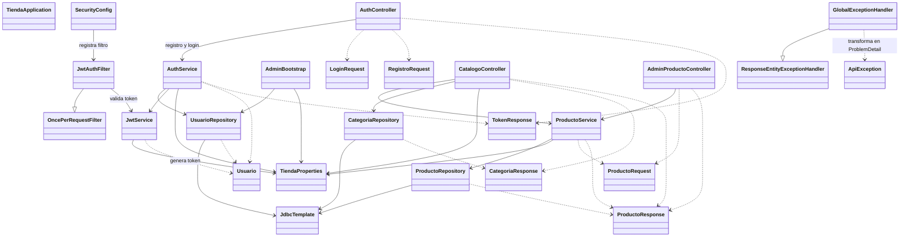

# tienda-api

Plantilla backend e-commerce (Spring Boot 3 + Java 21 + JDBC + PostgreSQL + Flyway), lista para Docker. El Compose de este proyecto levanta solo la API y se conecta al contenedor PostgreSQL existente `web_db`.

## Arrancar con Docker

```bash
cp .env.example .env
# Configura DB_NAME, DB_USER y DB_PASSWORD con los valores de tu PostgreSQL existente.
# Configura JWT_SECRET (min. 32 caracteres) y, si aplica, ADMIN_PASSWORD.
docker compose up -d --build
```

- API: http://192.168.0.150:8080
- Swagger: http://192.168.0.150:8080/swagger-ui.html
- Salud: http://192.168.0.150:8080/actuator/health
- PostgreSQL desde el host: `192.168.0.150:5433` (publicado por el Compose del contenedor de base de datos).

Antes de iniciar la API, el contenedor PostgreSQL debe estar activo, llamarse `web_db` y estar conectado a la red externa Docker `homelab_net`. La API conecta a `web_db:5432` dentro de esa red; `5433` es el puerto publicado para clientes que se conectan desde el host y no se usa entre contenedores. Flyway aplica las migraciones al arrancar la API. Si defines `ADMIN_PASSWORD`, se crea el usuario administrador (`ADMIN_EMAIL`) si todavía no existe.

## Funcionalidades implementadas

- Registro de clientes e inicio de sesión con correo y contraseña. Las contraseñas se almacenan con BCrypt y las respuestas exitosas entregan un JWT Bearer.
- Autenticación sin sesión mediante JWT. Los endpoints administrativos requieren el rol `ADMIN`; los endpoints de lectura del catálogo son públicos.
- Consulta de la configuración visible de la tienda y de categorías activas.
- Consulta pública de productos activos con stock disponible, búsqueda por texto, filtro por categoría y paginación.
- Administración de productos para usuarios `ADMIN`: crear, actualizar y desactivar. La desactivación es lógica, por lo que conserva el producto y su historial.
- Respuestas de error en formato `ProblemDetail`, con validaciones en español y códigos HTTP diferenciados.

## API disponible

| Método | Endpoint | Acceso | Comportamiento |
| --- | --- | --- | --- |
| `POST` | `/api/auth/registro` | Público | Registra un cliente y devuelve un JWT (`201`). Requiere nombre, correo válido y contraseña de 8 a 72 caracteres. |
| `POST` | `/api/auth/login` | Público | Valida las credenciales y devuelve un JWT (`200`). Credenciales incorrectas o cuenta inactiva devuelven el mismo `401`. |
| `GET` | `/api/catalogo/tienda` | Público | Devuelve nombre, moneda, IVA y umbral de envío gratis. |
| `GET` | `/api/catalogo/categorias` | Público | Lista las categorías activas. |
| `GET` | `/api/catalogo/productos` | Público | Lista productos activos con stock. Acepta `categoriaId`, `q`, `page` y `size` (por defecto `0` y `12`; máximo `50`). |
| `GET` | `/api/catalogo/productos/{id}` | Público | Devuelve el detalle si el producto está activo y tiene stock; de lo contrario devuelve `404`. |
| `POST` | `/api/admin/productos` | `ADMIN` | Crea producto e inventario inicial (`201`). |
| `PUT` | `/api/admin/productos/{id}` | `ADMIN` | Actualiza producto e inventario; devuelve `404` si no existe. |
| `DELETE` | `/api/admin/productos/{id}` | `ADMIN` | Desactiva el producto sin borrarlo físicamente (`204`). |
| `GET` | `/actuator/health` | Público | Estado de salud de la API. |

`ProductoRequest` valida SKU obligatorio (máximo 50 caracteres), nombre obligatorio (máximo 200), precio no negativo, categoría y stock obligatorios, y garantía/stock mínimo no negativos. Los mensajes de validación se devuelven en español dentro de `errores`, indexados por campo; la garantía y el stock mínimo son opcionales.

Para las rutas protegidas, envía `Authorization: Bearer <token>`. Sin autenticación válida se responde `401`; con sesión válida pero sin el rol requerido, `403`. Los datos inválidos o el JSON mal formado responden `400`; las restricciones de datos responden `409`. El token expira según `tienda.jwt.expiracion-minutos`.

## Verificación manual en homelab

Estas respuestas se comprobaron contra la API desplegada. No representan una garantía de que todos los casos posibles estén cubiertos.

| Prueba | Resultado observado |
| --- | --- |
| `GET /actuator/health` | `200`, estado `UP` |
| `GET /api/catalogo/tienda` | `200` |
| `GET /api/catalogo/categorias` | `200`, categorías activas |
| `GET /api/catalogo/productos` | `200`, actualmente `[]` porque no hay productos activos con stock |
| Registro y login de cliente | `201` y `200` |
| Login con credenciales incorrectas | `401` |
| Registro inválido o JSON mal formado | `400` |
| Registro con correo ya existente | `409` |
| Ruta ADMIN sin token o con token inválido | `401` |
| Ruta ADMIN con token de `CLIENTE` | `403` |
| Producto inexistente o no disponible | `404` |
| Crear, actualizar y desactivar producto con token `ADMIN` | `201`, `200` y `204` |

Los errores comprobados usan `ProblemDetail`. Sus mensajes principales son:

| HTTP | Caso | Mensaje `detail` |
| --- | --- | --- |
| `400` | Validación | `Los datos enviados no son válidos.`; el objeto `errores` detalla cada campo. |
| `400` | JSON mal formado | `El cuerpo de la solicitud no contiene JSON válido.` |
| `401` | Login incorrecto | `Correo o contraseña incorrectos.` |
| `401` | Token ausente o inválido | `Autenticación requerida: inicia sesión o proporciona un token válido.` |
| `403` | Rol insuficiente | `No tienes permisos para realizar esta operación.` |
| `404` | Producto inexistente/no disponible | `Producto no encontrado` |
| `409` | Correo duplicado | `El correo ya está registrado.` |
| `409` | Excepción de integridad de datos | `La operación viola una restricción de datos (duplicado o referencia inexistente).` |
| `500` | Error inesperado | `Error interno del servidor` (el detalle se registra en logs y no se entrega al cliente). |

En la capa de servicio, una excepción `DataIntegrityViolationException` devuelve `409`. Las reglas SQL de V3 pueden traducirse según el driver y la operación; la traducción específica de SQLSTATE `P0001` debe confirmarse con una prueba de integración contra PostgreSQL. El `500` se probó con una excepción inesperada controlada en `MockMvc`, no provocándolo en el homelab.

Los paquetes `carrito`, `inventario`, `pedidos`, `pagos` y `envios` aún no implementan endpoints ni lógica de negocio; sus tablas o migraciones no implican que esas funciones estén disponibles en la API.

## Pruebas automatizadas

```bash
# Suite completa: unitarias, MockMvc e integración PostgreSQL
mvn clean test

# Solo integración contra PostgreSQL efímera (Testcontainers)
mvn -Dtest=PostgresIntegrationTest test
```

Las pruebas unitarias y MVC no usan una base de datos. `PostgresIntegrationTest` levanta PostgreSQL 16 con Testcontainers, aplica las migraciones y prueba persistencia, autenticación, productos y el trigger de stock. Para que estas pruebas se ejecuten, Docker debe estar disponible; si no hay daemon, Testcontainers las marca como omitidas. Revisa el resumen Surefire y confirma `Skipped: 0` para saber que la parte de base de datos sí corrió. Nunca configura la base del homelab como destino de pruebas.

## Probar

```bash
# Login admin
curl -s -X POST localhost:8080/api/auth/login -H 'Content-Type: application/json' \
  -d '{"email":"admin@tienda.local","password":"TU_ADMIN_PASSWORD"}'

# Crear producto (usa el token del login)
curl -s -X POST localhost:8080/api/admin/productos -H "Authorization: Bearer TOKEN" \
  -H 'Content-Type: application/json' \
  -d '{"sku":"LAP-001","nombre":"Portatil 15 pulgadas","precio":2500000,"categoriaId":1,"stock":10}'

# Catalogo publico
curl -s localhost:8080/api/catalogo/productos
```

### Probar errores y validaciones

```bash
# Credenciales incorrectas: HTTP 401 y mensaje generico
curl -i -X POST http://localhost:8080/api/auth/login \
  -H 'Content-Type: application/json' \
  -d '{"email":"no-existe@example.invalid","password":"incorrecta"}'

# Validaciones de registro: HTTP 400 con errores por campo
curl -i -X POST http://localhost:8080/api/auth/registro \
  -H 'Content-Type: application/json' \
  -d '{"nombre":"","email":"correo-invalido","password":"123"}'

# JSON mal formado: HTTP 400
curl -i -X POST http://localhost:8080/api/auth/registro \
  -H 'Content-Type: application/json' -d '{'

# Ruta ADMIN sin token: HTTP 401
curl -i -X POST http://localhost:8080/api/admin/productos \
  -H 'Content-Type: application/json' -d '{}'

# Ruta ADMIN con token CLIENTE: HTTP 403; TOKEN_CLIENTE debe ser un JWT vigente
curl -i -X POST http://localhost:8080/api/admin/productos \
  -H "Authorization: Bearer $TOKEN_CLIENTE" \
  -H 'Content-Type: application/json' -d '{}'

# Producto inexistente/no disponible: HTTP 404
curl -i http://localhost:8080/api/catalogo/productos/999999999
```

## Estructura del proyecto

```text
tienda-api/
├── CHANGELOG.md
├── Dockerfile
├── docker-compose.yml
├── pom.xml
├── README.md
└── src/main/
  ├── java/com/codeconheiner/tienda/
  │   ├── TiendaApplication.java
  │   ├── auth/
  │   │   ├── AuthController.java
  │   │   ├── AuthService.java
  │   │   ├── JwtAuthFilter.java
  │   │   ├── JwtService.java
  │   │   └── dto/ (LoginRequest, RegistroRequest, TokenResponse)
  │   ├── catalogo/
  │   │   ├── AdminProductoController.java
  │   │   ├── CatalogoController.java
  │   │   ├── CategoriaRepository.java
  │   │   ├── CategoriaResponse.java
  │   │   ├── ProductoRepository.java
  │   │   ├── ProductoRequest.java
  │   │   ├── ProductoResponse.java
  │   │   └── ProductoService.java
  │   ├── common/ (ApiException, GlobalExceptionHandler)
  │   ├── config/ (AdminBootstrap, SecurityConfig, TiendaProperties)
  │   ├── usuarios/ (Usuario, UsuarioRepository)
  │   ├── carrito/     (paquete reservado)
  │   ├── envios/      (paquete reservado)
  │   ├── inventario/  (paquete reservado)
  │   ├── pagos/       (paquete reservado)
  │   └── pedidos/     (paquete reservado)
  └── resources/
    ├── application.yml
    └── db/migration/
      ├── V1__esquema_inicial.sql
      ├── V2__datos_semilla.sql
      └── V3__reglas_negocio.sql
```

Los paquetes marcados como reservados todavía no contienen lógica de negocio. La autenticación, el catálogo, la configuración y el acceso a usuarios sí están implementados.

## UML de clases



## Reutilizar la plantilla

Cambia solo `tienda.*` en `application.yml` (o las variables del `.env`), las categorias semilla en `V2` y el frontend.
